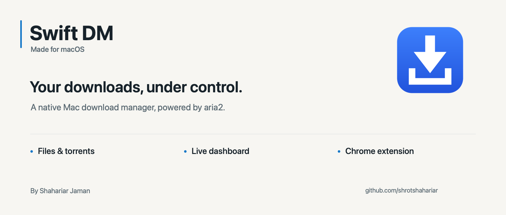

<picture>
  <source media="(prefers-color-scheme: dark)" srcset="banner-dark.png">
  
</picture>

<p align="center">
  <a href="https://github.com/shrotshahariar/swift-download-manager/releases/download/v1.1.0/Swift-DM-macOS-arm64.zip"></a>
</p>
<p align="center"><strong>macOS 14+ · Apple silicon</strong><br>Built with SwiftUI · Powered by bundled aria2</p>
<p align="center"><a href="https://github.com/shrotshahariar/swift-download-manager/releases/latest">Release notes</a> · <a href="https://github.com/shrotshahariar/swift-download-manager/issues">Report an issue</a> · <a href="#install-on-a-mac">Installation</a></p>

---

## Swift DM

Manage files, torrents, and magnet links in a native Mac app. Follow transfers, control their speed, and send downloads over from Chrome.

## Download

**[Download Swift DM for macOS](https://github.com/shrotshahariar/swift-download-manager/releases/download/v1.1.0/Swift-DM-macOS-arm64.zip)** · [All releases](https://github.com/shrotshahariar/swift-download-manager/releases)

| Release | Requires | Mac support |
| --- | --- | --- |
| Swift DM 1.1.0 | macOS 14 or later | Apple silicon |

## Install on a Mac

1. Download the ZIP, extract it, and move **Swift DM.app** into **Applications**.
2. Open the app. This release is ad-hoc signed and has not been notarized by Apple.
3. If macOS blocks it, open **System Settings → Privacy & Security → Open Anyway**, then confirm that you want to open this downloaded app.

Updating? Quit the running app first, then replace the copy in Applications.

## What it does

| Your downloads | Your controls |
| --- | --- |
| **Files and torrents** | HTTP, HTTPS, FTP, BitTorrent, and magnet links; up to 16 connections per file. |
| **A live dashboard** | Speed graphs, active tasks, transfer totals, disk space, and an activity heatmap. |
| **A queue you can manage** | Pause, resume, restart, search, and switch between downloading, waiting, completed, and stopped tasks. |
| **Torrent details** | Select files and inspect activity, peers, trackers, and the piece map. |
| **Menu-bar access** | See live speed, pause or resume all tasks, and toggle speed limits. |
| **Your preferred layout** | Reorder and resize dashboard widgets, use presets, and choose light or dark appearance. |

Drag links, magnets, or torrent files onto the window to add them. Downloads survive quitting and relaunching. Swift DM can keep your Mac awake during transfers and notify you when they finish or fail.

## Add the Chrome or Chrome Beta extension

**[Download the Chrome extension](https://github.com/shrotshahariar/swift-download-manager/releases/download/v1.1.0/Swift-DM-Chrome-Extension.zip)**

1. Extract the ZIP. In Chrome or Chrome Beta, open `chrome://extensions` and enable **Developer mode**.
2. Choose **Load unpacked** and select the extracted extension folder.
3. In Swift DM, open **Settings → Browser → Copy Key**.
4. Paste that pairing key into the extension’s popup.

Chrome downloads can now go to Swift DM. You can also right-click a link and choose **Download with Swift DM**. If the app is not running, Chrome downloads normally.

## What changed in 1.1.0

- Fixed a layout crash when moving the app window between monitors.
- Compact, draggable windows keep the same size across monitors and open centered on the display where you launch them. Their shared size stays below 35% of every connected display.
- Refreshed app artwork and a properly sized 22-point menu icon.
- More responsive engine shutdown/restarts and less repeated dashboard and polling work.

## Build it yourself

With Apple’s Command Line Tools installed:

```sh
cd app
./build.sh
```

The app is written to `app/build/Swift DM.app`. The engine is bundled in `app/vendor/aria2c`; Motrix does not need to be installed. To select another engine, pass `ARIA2=/path/to/aria2c`.

Run `./test-window-sizing.sh` from `app` for the window and multi-monitor regression checks.

[Read the full guide](GUIDE.md) for download options, proxies, BitTorrent settings, and dashboard controls.

## Troubleshooting and limits

If transfers stay at 0 B/s with LuLu enabled, allow `Swift DM.app/Contents/Resources/aria2c` in the firewall. Rebuilding can cause LuLu to ask again.

HLS/DASH joining, UPnP port mapping, automatic app updates, plugins, CLI/Docker server mode, and translations are not included.

## Engine and credits

Swift DM is modeled on [Motrix](https://github.com/agalwood/Motrix) and uses aria2. The published app bundles `1.37.0-motrix.23`, which reports GNU GPL version 2 or later. See [third-party notices](THIRD_PARTY_NOTICES.md).

## Support and updates

[Release notes](https://github.com/shrotshahariar/swift-download-manager/releases/latest) · [Changelog](CHANGELOG.md) · [Report an issue](https://github.com/shrotshahariar/swift-download-manager/issues)

Include your app and macOS versions and the transfer type. Remove private URLs, cookies, pairing keys, or authorization headers from reports.

Made by [Shahariar Jaman](https://github.com/shrotshahariar).
